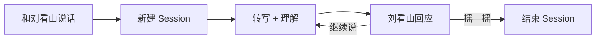
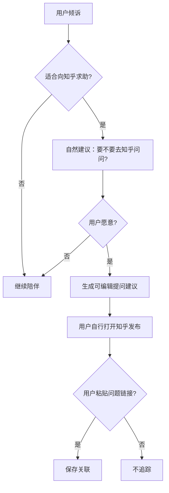
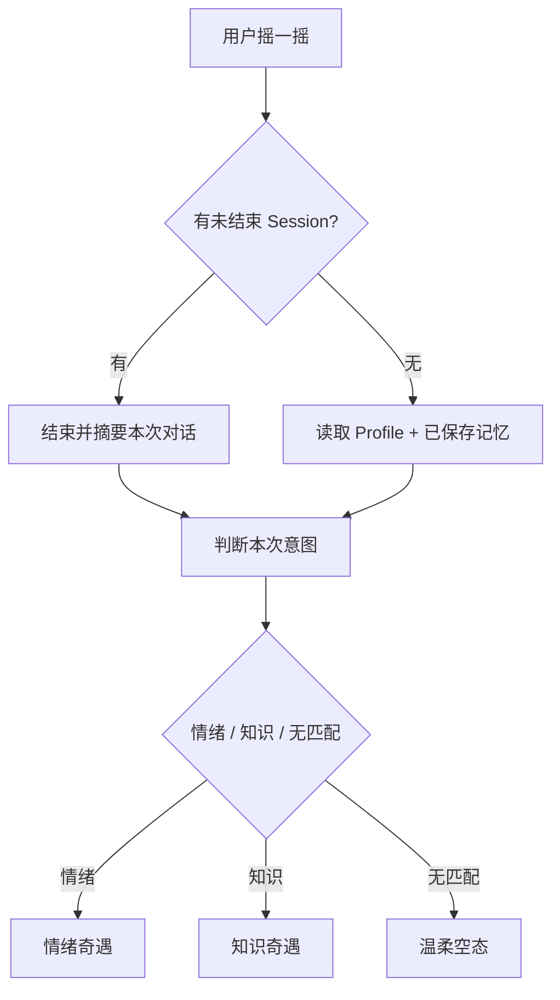
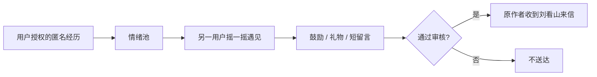
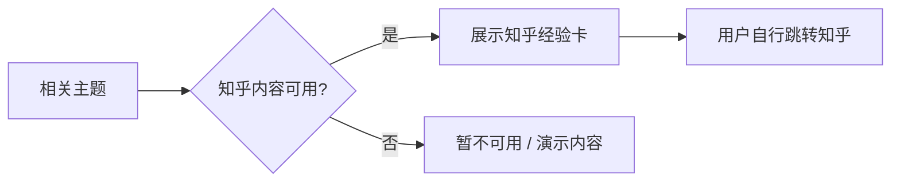
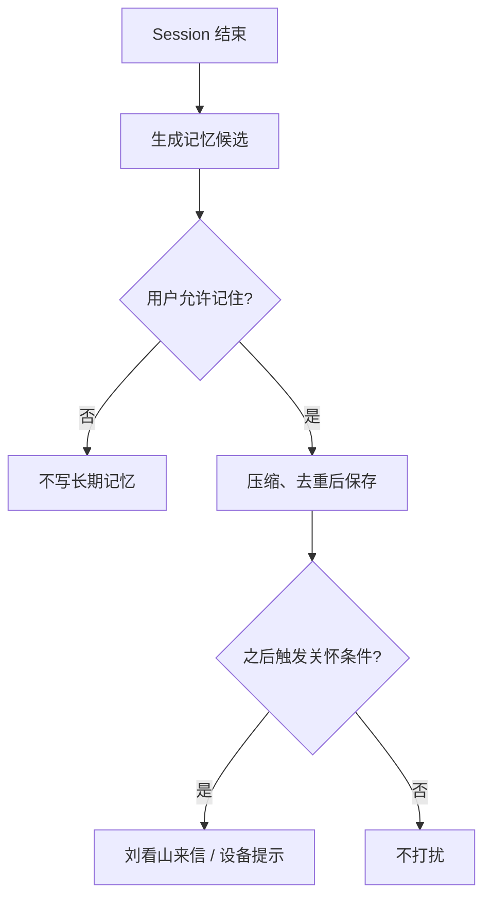

# 刘看山 AI 掌心萌宠｜产品 PRD V1.0

> 产品侧版本｜2026-11-20

## 01 一句话

用户和刘看山持续说话；刘看山记住被允许记住的事，在摇一摇后带来情绪或知识奇遇，并把陌生人的善意变成一封来信。

| 核心 | 用户得到什么 |
| --- | --- |
| 连续陪伴 | 多说几句也不用重复前情 |
| 奇遇 | 有人走过相似的路，或看到一条相关的知乎经验 |
| 被记住 | 烦恼在之后合适的时刻被温柔提起 |

## 02 页面清单

### 掌心设备

| ID / 页面 | 显示 | 用户操作 | 反馈 / 去向 | 空状态或失败 |
| --- | --- | --- | --- | --- |
| H01 待机 | 萌宠表情、短句、未读来信点 | 进入对话 / 摇一摇 / 看来信 | H02 / H05 / H08 | 离线：等我连上再陪你 |
| H02 连续对话 | 按住说话与倾听动画；未产生转写时上方不显示气泡框，松开后短暂显示最多两行的本轮用户转写，约 4–5 秒后文字和气泡框一起消失 | 继续说 | 保持同一 Session，进入 H03/H04 | 听不清：再说一次 |
| H03 思考 | 简短思考动画 | 等待 / 取消 | H04 / H01 | 超时：稍后再试 |
| H04 回应 | 短回复持续显示，直到下一次模型回复替换 | 继续说 / 摇一摇 | H02 / H05 | 安抚短句+重试 |
| H05 摇一摇 | 两只不同配色的看山在雪丘相遇，不标注双方称呼 | 摇一摇 | 结束本次 Session，H06/H07/H01 | 无匹配：温柔空态 |
| H06 情绪奇遇 | 雪丘背景、对方形象、匿名昵称与简短分享气泡；无展开/收起、无页面标题 | 按住助力 / 关闭 | 助力送出反馈 / H01 | 无内容：回 H01 |
| H07 知识奇遇 | 知乎标题、来源标识 | 打开手机 | W06 | 暂不可用：明确说明 |
| H08 来信 | 信封、短句、未读数 | 查看 / 忽略 | W07 / H01 | 无来信：不显示未读点 |

### 手机 Web

| ID / 页面 | 显示 | 用户操作 | 反馈 / 去向 | 空状态或失败 |
| --- | --- | --- | --- | --- |
| W01 首页 | 设备状态、继续对话、未读来信 | 查看详情 | W02 / W07 | 设备离线：最后同步时间 |
| W02 对话记录 | 转写、回复、摘要 | 查看、删除 | W03 / W04 | 无记录：去和刘看山说话 |
| W03 我的记忆 | Profile、记忆卡、记住开关 | 编辑、删除、停用 | 保存后回 W02 | 无记忆：可随时让刘看山忘记 |
| W04 知乎提问建议 | 可编辑标题/正文、复制、打开知乎 | 编辑 → 复制/打开知乎 → 粘贴问题链接 | 外部知乎 / W02 | 不想发：返回对话；链接无效：不关联 |
| W05 情绪奇遇 | 匿名经历、鼓励、礼物、短留言 | 回应 / 略过 | 成功提示 / W01 | 无内容、下架、频繁：说明原因 |
| W06 知识奇遇 | 知乎经验卡、来源、外跳 | 打开知乎 / 不感兴趣 | 外部知乎 / W01 | 暂不可用/演示内容 |
| W07 刘看山来信 | 来信、关联的鼓励或经历 | 阅读、隐藏、关闭提醒 | W01 / W03 | 无来信：空态 |
| W08 设置 | 情绪奇遇、礼物、提醒、免打扰 | 开关、举报、撤回分享 | 保存后回 W01 | 保存失败：不改变原设置 |

## 03 用户链路

### 日常陪伴与连续倾诉

### AI 自然引导知乎提问

### 摇一摇：有 Session / 无 Session

### 情绪奇遇与来信

### 知识奇遇

### 记忆与主动关怀

## 04 AI 怎么判断

### AI 记住什么

| 层 | 是什么 | 用来做什么 | 用户能做什么 |
| --- | --- | --- | --- |
| Profile | 长期偏好：语气、兴趣、提醒开关 | 决定陪伴方式 | 修改、关闭 |
| Memory | 被允许记住的摘要：烦恼、偏好、重要变化 | 后续理解、奇遇、关怀 | 查看、编辑、删除、停用 |
| Session | 本次连续对话的多句话和摘要 | 理解“刚刚说的事” | 摇一摇结束本次 Session |

### 对话与 Session

| 条件 | 是 | 否 |
| --- | --- | --- |
| 用户开始说话时，有未结束 Session？ | 接着聊，使用本次已说内容 | 新建 Session |
| 本句话听清了吗？ | 理解情绪、主题、需求并回应 | 提示“我没听清，再说一次” |
| 用户还在继续说吗？ | 追加本次 Session，继续对话 | 等待用户下一步 |
| 用户摇一摇了吗？ | 结束 Session，先摘要，再去匹配奇遇 | Session 继续 |
| 用户取消本次倾诉了吗？ | 不生成奇遇；不写长期记忆 | 正常继续 |

### 什么时候建议去知乎提问

| 条件 | 是 | 否 |
| --- | --- | --- |
| 用户在问具体问题、需要真实经验或多人观点？ | 自然建议“要不要去知乎问问” | 先陪伴，不推知乎 |
| 内容强隐私、危险，或用户只是想被倾听？ | 不建议公开提问，优先陪伴与安全提醒 | 进入下一判断 |
| 用户接受建议？ | 生成可编辑草稿，用户自行打开知乎发布 | 留在对话里 |
| 用户主动粘贴知乎问题链接？ | 记录链接，后续可打开 | 不追踪发布结果 |

### 什么时候写长期记忆

| 条件 | 是 | 否 |
| --- | --- | --- |
| Session 结束后，出现值得长期记住的事？ | 生成一句记忆候选 | 不生成候选 |
| 用户允许记住？ | 压缩、去重、保存到 Memory | 只保留本次 Session |
| 新记忆与旧记忆重复或冲突？ | 合并或更新旧记忆 | 新建一条 |
| 用户删除/停用记忆？ | 不再用于回应、奇遇或主动关怀 | 继续按当前授权使用 |

### 摇一摇后给什么

| 条件 | 是 | 否 |
| --- | --- | --- |
| 摇前有 Session？ | 用本次 Session + Memory + Profile 判断意图 | 只用 Profile + 已保存 Memory |
| 用户现在更需要被理解、相似经历？ | 给情绪奇遇 | 判断知识奇遇 |
| 用户现在在寻找方法、信息或经验？ | 给知识奇遇 | 返回温柔空态 |
| 有合适且可展示的内容？ | 展示一张卡 | 不编造内容；显示空态 |
| 用户已看过/隐藏同一内容？ | 不再原样重复推送 | 正常展示 |

### 情绪奇遇与陌生人互动

| 条件 | 是 | 否 |
| --- | --- | --- |
| 原作者允许把经历匿名放入情绪池？ | 可被其他人随机遇见 | 永远只留在原作者私密空间 |
| 遇见者要回应？ | 只能送鼓励、礼物或短留言 | 可略过，不产生关系 |
| 留言通过审核？ | 原作者收到来信 | 不送达，并告知发送者 |
| 原作者关闭陌生人互动？ | 不再接收后续鼓励/礼物/留言 | 保持当前设置 |

### 主动关怀

| 条件 | 是 | 否 |
| --- | --- | --- |
| 有仍在使用的 Memory，且与今天/新奇遇相关？ | 生成关怀候选 | 不主动提起 |
| 用户开启提醒，且不在免打扰时间？ | 设备显示短句，Web 收到来信 | 只在 Web 信箱保留，不打扰 |
| 本周期已收到足够提醒？ | 不再推送 | 可发送一次 |
| 用户关闭某条记忆？ | 立即停止围绕它的关怀 | 继续按授权关怀 |

## 05 验收标准

| 编号 | 验收场景 | 通过条件 |
| --- | --- | --- |
| A01 | 连续对话 | 用户连续说 3 句，刘看山能引用前两句；摇一摇后 Session 结束 |
| A02 | 私密默认 | 未授权的倾诉不会进入情绪池，也不会被其他用户看到 |
| A03 | 记忆 | 用户允许记住后，Web 可看到一句压缩记忆；删除后刘看山不再引用它 |
| A04 | 知乎引导 | AI 只在合适时建议；用户可编辑草稿并自行打开知乎；系统不会自动发布 |
| A05 | 有 Session 摇一摇 | 摇一摇先结束对话，再返回情绪奇遇、知识奇遇或空态之一 |
| A06 | 无 Session 摇一摇 | 待机摇一摇按 Profile/Memory 返回奇遇；没有内容时不编造 |
| A07 | 情绪奇遇 | B 只能看到 A 已授权的匿名经历；B 的回应不形成聊天关系 |
| A08 | 来信 | 鼓励审核通过后，A 在设备或 Web 收到来信；可阅读、隐藏、关闭提醒 |
| A09 | 知识奇遇 | 内容可用时可跳转知乎；不可用时明确显示“暂不可用/演示内容” |
| A10 | 主动关怀 | 只在用户允许、未免打扰、未超过频率时发起一次关怀 |
